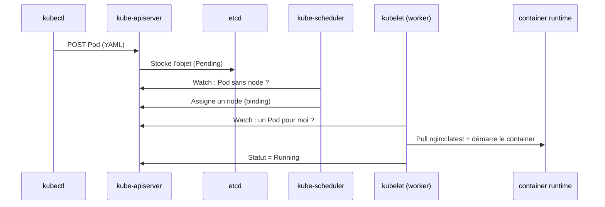

# Fiche — Le Pod

## 📌 En une phrase

Le **Pod** est la plus petite unité déployable dans Kubernetes : une enveloppe autour d'un ou plusieurs containers qui partagent **la même IP, le même réseau et les mêmes volumes**.

> Analogie : le container est un locataire, le Pod est l'appartement (adresse IP, boîte aux lettres, placards partagés).

## 🧠 À retenir

- Kubernetes ne gère jamais un container directement : il gère des **Pods**
- 1 Pod = généralement 1 container principal (+ éventuellement des *sidecars*)
- Un Pod est **éphémère** : s'il meurt, il n'est pas recréé tout seul → c'est le rôle des Deployments / ReplicaSets
- Les **labels** (`app: nginx_app`) sont des étiquettes clé/valeur : c'est grâce à eux que Services et Deployments retrouvent leurs Pods

## 🏗️ Ce qui se passe quand on fait `kubectl apply`



## 📄 Anatomie d'un manifest

```yaml
apiVersion: v1          # version de l'API (Pod = core v1)
kind: Pod               # type d'objet
metadata:
  name: pod-nginx       # nom unique dans le namespace
  labels:
    app: nginx_app      # étiquettes pour la sélection
spec:                   # l'état désiré
  containers:
    - name: nginx-container
      image: nginx:latest
```

Les 4 champs racines `apiVersion / kind / metadata / spec` sont présents dans **tous** les objets Kubernetes.

## ⌨️ Commandes clés

| Besoin | Commande |
|---|---|
| Créer rapidement | `kubectl run <nom> --image=` |
| Générer un YAML | `kubectl run <nom> --image= --dry-run=client -o yaml` |
| Appliquer un YAML | `kubectl apply -f pod.yaml` |
| Lister + labels | `kubectl get pods --show-labels` |
| Détail + events | `kubectl describe pod <nom>` |
| Logs | `kubectl logs <nom> [-c <container>]` |
| Shell dans le container | `kubectl exec -it <nom> -- sh` |
| Supprimer | `kubectl delete pod <nom>` |

## 🚨 Pièges courants

- `kubectl run` ne permet pas de choisir le nom du container → YAML obligatoire
- `ContainerCreating` qui dure → image en cours de pull (`describe` → Events)
- `ImagePullBackOff` → nom ou tag d'image faux
- On ne modifie pas la plupart des champs d'un Pod existant : on le supprime et on le recrée

## 🎤 Question d'entretien

**Pourquoi ne déploie-t-on presque jamais de Pod « nu » en production ?**
Parce qu'un Pod n'est pas auto-réparé : s'il tombe ou si son node meurt, il disparaît. Un Deployment (via un ReplicaSet) garantit le nombre de réplicas voulu et gère les mises à jour.
