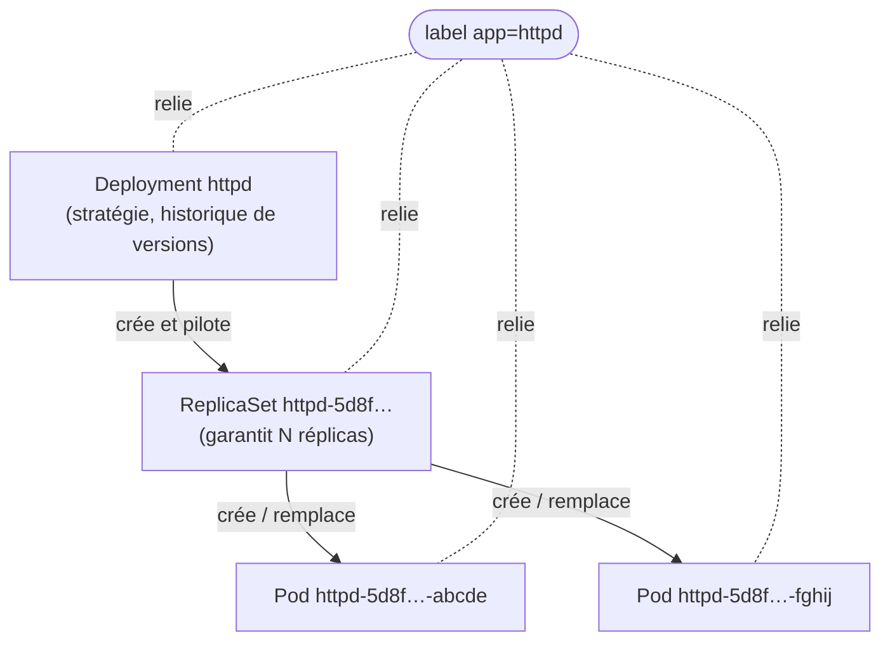
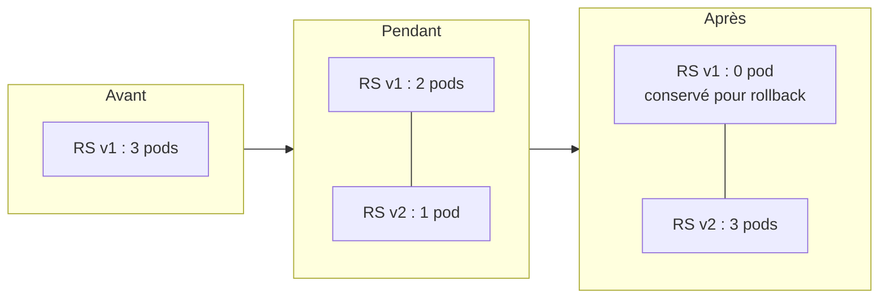

# Fiche — Le Deployment

## 📌 En une phrase

Le **Deployment** décrit l'état voulu d'une application (image, nombre de réplicas) et Kubernetes s'occupe en permanence de le faire respecter : auto-réparation, scaling et mises à jour sans coupure.

> Analogie : le Pod est un employé, le ReplicaSet est le chef d'équipe qui remplace tout absent, le Deployment est le RH qui gère les changements de poste (nouvelle version) sans fermer le service.

## 🏗️ La hiérarchie



## 🔄 Rolling update (changement d'image)



L'ancien ReplicaSet est gardé à 0 réplica : c'est ce qui rend `kubectl rollout undo` instantané.

## 📄 Anatomie du manifest

```yaml
apiVersion: apps/v1        # ⚠️ apps/v1, pas v1
kind: Deployment
metadata:
  name: httpd
spec:
  replicas: 1
  selector:
    matchLabels:
      app: httpd           # ① quels pods je gère…
  template:                # ② …le modèle de ces pods
    metadata:
      labels:
        app: httpd         # doit correspondre à ①
    spec:
      containers:
        - name: httpd
          image: httpd:latest
```

## ⌨️ Commandes clés

| Besoin | Commande |
|---|---|
| Créer | `kubectl create deployment <nom> --image=` |
| Générer le YAML | `... --dry-run=client -o yaml` |
| Scaler | `kubectl scale deployment <nom> --replicas=3` |
| Changer l'image | `kubectl set image deployment/<nom> <container>=` |
| Suivre un déploiement | `kubectl rollout status deployment/<nom>` |
| Historique | `kubectl rollout history deployment/<nom>` |
| Revenir en arrière | `kubectl rollout undo deployment/<nom>` |
| Voir toute la chaîne | `kubectl get deploy,rs,pods -l app=<nom>` |

## 🚨 Pièges courants

- `apiVersion: apps/v1` (et non `v1` comme pour un Pod)
- `selector` qui ne correspond pas aux labels du template → erreur à la création
- Le container s'appelle comme l'image (`httpd`) avec `kubectl create deployment`
- `:latest` en prod = version non maîtrisée → épingler un tag précis

## 🎤 Question d'entretien

**Quelle différence entre un ReplicaSet et un Deployment ?**
Le ReplicaSet maintient un nombre de pods identiques. Le Deployment gère des ReplicaSets successifs pour faire des mises à jour progressives et des rollbacks. On ne manipule quasiment jamais un ReplicaSet directement.
