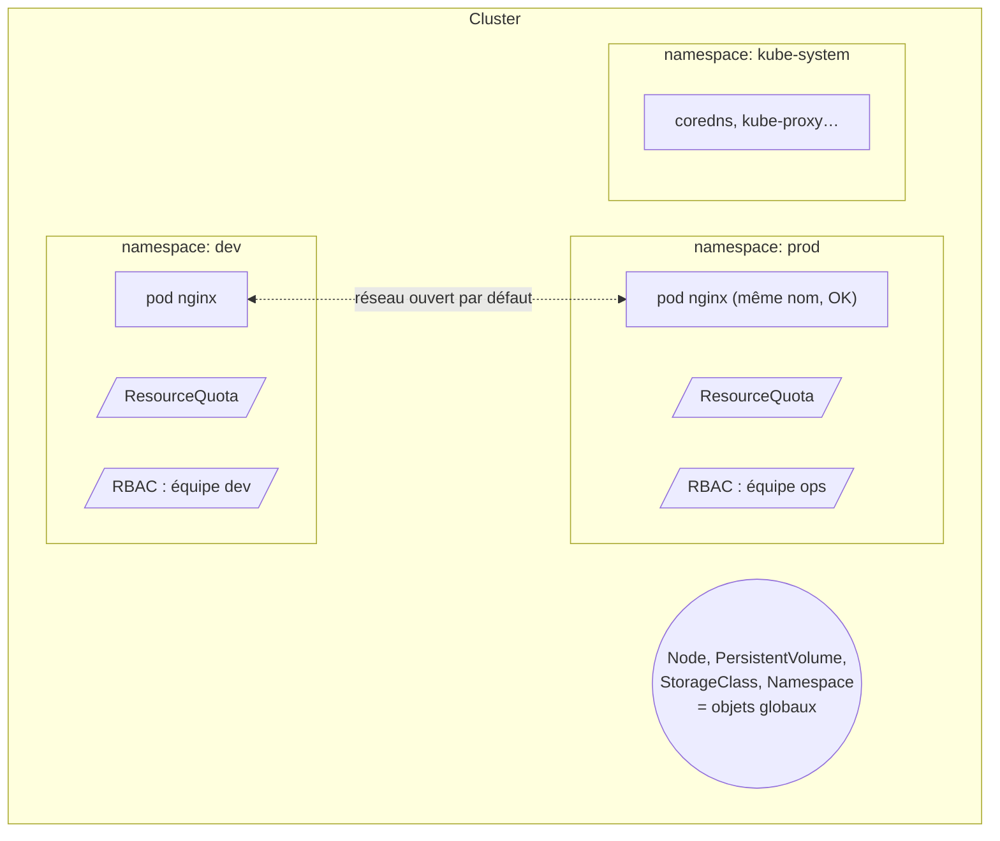

# Fiche — Le Namespace

## 📌 En une phrase

Un **Namespace** est un **dossier logique** qui découpe un cluster en espaces séparés : chacun a ses propres noms d'objets, quotas et droits d'accès.

> Analogie : le cluster est un immeuble, les namespaces sont les appartements. Deux appartements peuvent avoir chacun une pièce appelée « cuisine », mais les couloirs (le réseau) restent communs tant qu'on ne pose pas de porte (NetworkPolicy).

## 🏗️ Vue d'ensemble

## 🧠 À retenir

- Namespaces présents par défaut : `default`, `kube-system` (composants du cluster), `kube-public`, `kube-node-lease`
- Ce qui est **par namespace** : Pods, Deployments, Services, ConfigMaps, Secrets, ServiceAccounts…
- Ce qui est **global** : Nodes, PersistentVolumes, StorageClasses, ClusterRoles, les Namespaces eux-mêmes
- Pour lister les deux catégories : `kubectl api-resources --namespaced=true|false`
- DNS entre namespaces : `<service>.<namespace>.svc.cluster.local`

## ⌨️ Commandes clés

| Besoin | Commande |
|---|---|
| Créer | `kubectl create namespace dev` |
| Lister | `kubectl get ns` |
| Travailler dans un namespace | `kubectl get pods -n dev` |
| Tous les namespaces | `kubectl get pods -A` |
| Changer le namespace par défaut | `kubectl config set-context --current --namespace=dev` |
| Supprimer (⚠️ supprime TOUT dedans) | `kubectl delete ns dev` |

## 🚨 Pièges courants

- Oublier `-n` → l'objet est créé ou cherché dans `default`
- `kubectl delete ns` efface tous les objets qu'il contient, sans confirmation
- Croire que le namespace isole le réseau : il faut une **NetworkPolicy**
- Un namespace bloqué en `Terminating` → souvent un *finalizer* qui attend une ressource

## 🎤 Question d'entretien

**Un namespace suffit-il à isoler deux équipes sur un même cluster ?**
Non. Il isole les noms et sert de périmètre pour RBAC et ResourceQuota, mais par défaut tous les pods peuvent communiquer entre eux. Il faut ajouter des NetworkPolicies, et pour une isolation forte (multi-tenant hostile) des clusters ou des nodes dédiés.
