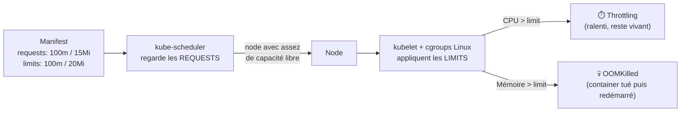
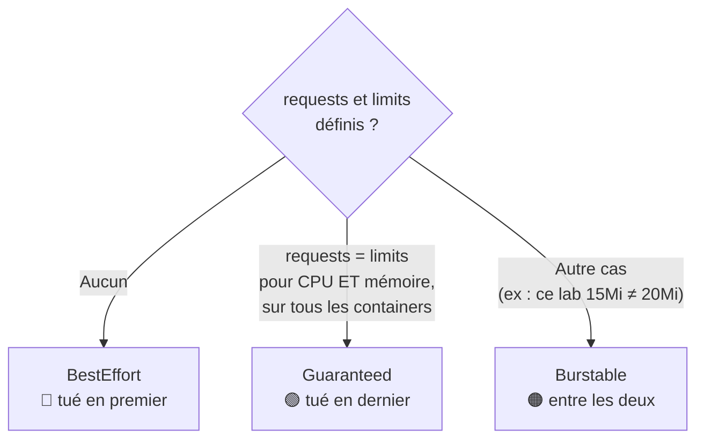

# Fiche — Requests & Limits (ressources CPU / mémoire)

## 📌 En une phrase

Les **requests** disent à Kubernetes combien un container a besoin pour être **placé** sur un node ; les **limits** fixent le **plafond** qu'il n'a jamais le droit de dépasser.

> Analogie : au restaurant, la *request* c'est la réservation (on te garde une table de 2), la *limit* c'est la capacité max de la table (impossible d'y asseoir 5 personnes).

## 🏗️ Qui utilise quoi ?



**CPU = ressource compressible** (on peut la ralentir) → throttling.
**Mémoire = ressource incompressible** (on ne peut pas « reprendre » de la RAM) → kill.

## 📏 Unités

| Ressource | Unité | Exemple |
|---|---|---|
| CPU | cœur ou millicœur (`m`) | `100m` = 0,1 CPU ; `1` = 1 cœur |
| Mémoire | `Ki`, `Mi`, `Gi` (puissances de 2) | `20Mi` ≈ 20,97 Mo |
| Mémoire | `K`, `M`, `G` (puissances de 10) | `20M` = 20 000 000 octets |

⚠️ `Mi` ≠ `M` et `m` en mémoire = **milli-octet** (piège classique : `500m` de RAM = 0,5 octet !)

## 🎚️ Classes QoS (qui est tué en premier quand le node manque de RAM)



Vérifier : `kubectl get pod <nom> -o jsonpath='{.status.qosClass}'`

## 📄 Manifest du lab

```yaml
spec:
  containers:
    - name: httpd-container
      image: httpd:latest
      resources:
        requests:          # réservé au scheduling
          memory: "15Mi"
          cpu: "100m"
        limits:            # plafond à l'exécution
          memory: "20Mi"
          cpu: "100m"
```

## ⌨️ Commandes clés

| Besoin | Commande |
|---|---|
| Voir les ressources d'un pod | `kubectl get pod <nom> -o jsonpath='{.spec.containers[*].resources}'` |
| Voir la classe QoS | `kubectl get pod <nom> -o jsonpath='{.status.qosClass}'` |
| Capacité / allocations d'un node | `kubectl describe node <node>` (section *Allocated resources*) |
| Consommation réelle (metrics-server) | `kubectl top pod` / `kubectl top node` |
| Modifier les ressources d'un Deployment | `kubectl set resources deploy/<nom> --requests=cpu=100m --limits=memory=64Mi` |

## 🚨 Pièges courants

- `kubectl run` ne permet plus de définir requests/limits → YAML
- Pod en **Pending** avec `Insufficient cpu/memory` → requests trop élevées pour les nodes
- **OOMKilled** / `CrashLoopBackOff` → limit mémoire trop basse (voir `describe` → *Last State*)
- Limit sans request → Kubernetes copie la limit dans la request
- Limits CPU trop serrées = latence cachée (throttling silencieux)

## 🎤 Question d'entretien

**Quelle différence de comportement entre dépasser sa limit CPU et sa limit mémoire ?**
Le CPU est compressible : le container est simplement ralenti (throttling via les cgroups). La mémoire ne l'est pas : le noyau tue le processus (OOMKilled) et le kubelet redémarre le container selon la `restartPolicy`.
