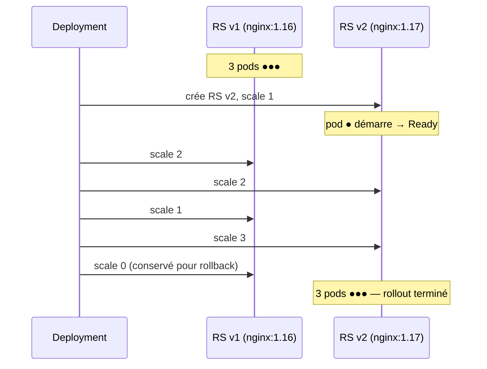

# Fiche — Rolling update & rollback

## 📌 En une phrase

Le **rolling update** remplace les pods d'un Deployment **petit à petit** par des pods de la nouvelle version, pour mettre à jour une application **sans interruption de service** — et le **rollback** permet de revenir en arrière en une commande.

> Analogie : changer les roues d'un bus… pendant qu'il roule, une roue à la fois, en gardant toujours assez de roues au sol.

## 🏗️ Déroulé d'une bascule (3 réplicas, maxSurge=1, maxUnavailable=0)

## 🎛️ Les deux curseurs

| Paramètre | Signification | Défaut | Effet |
|---|---|---|---|
| `maxSurge` | pods **en plus** autorisés pendant la bascule | 25 % | ↑ = plus rapide, plus de ressources consommées |
| `maxUnavailable` | pods **manquants** tolérés pendant la bascule | 25 % | 0 = zéro coupure, mais besoin de surge |

Autre stratégie : `type: Recreate` → tout supprimer puis tout recréer (coupure, mais jamais deux versions en même temps — utile si l'app ne supporte pas la cohabitation de versions).

## 🧠 À retenir

- Seule une modification du **template du pod** (image, env, labels du template…) déclenche un rollout ; changer `replicas` non
- Chaque rollout = une **révision** ; l'historique est conservé via les anciens ReplicaSets (`revisionHistoryLimit`, 10 par défaut)
- Les **readiness probes** conditionnent la bascule : un pod non prêt bloque la suite → un bug ne se propage pas à tous les pods

## ⌨️ Commandes clés

| Besoin | Commande |
|---|---|
| Trouver le nom du container | `kubectl get deploy <d> -o jsonpath='{.spec.template.spec.containers[*].name}'` |
| Changer l'image | `kubectl set image deployment/<d> <container>=<image:tag>` |
| Tous les containers | `kubectl set image deployment/<d> '*=<image:tag>'` |
| Suivre | `kubectl rollout status deployment/<d>` |
| Historique | `kubectl rollout history deployment/<d>` |
| Détail d'une révision | `kubectl rollout history deployment/<d> --revision=2` |
| Annuler (révision précédente) | `kubectl rollout undo deployment/<d>` |
| Revenir à une révision précise | `kubectl rollout undo deployment/<d> --to-revision=1` |
| Mettre en pause / reprendre | `kubectl rollout pause|resume deployment/<d>` |
| Redémarrer tous les pods | `kubectl rollout restart deployment/<d>` |
| Documenter la raison | `kubectl annotate deployment/<d> kubernetes.io/change-cause="maj nginx 1.17"` |

## 🚨 Pièges courants

- Mauvais nom de container dans `set image` → `error: unable to find container named ...`
- Image ou tag inexistant → nouveaux pods en `ImagePullBackOff`, rollout bloqué (les anciens pods continuent de servir) → `rollout undo`
- `rollout status` qui ne termine jamais → regarder `kubectl describe pod` sur les nouveaux pods
- `--record` est déprécié : utiliser l'annotation `kubernetes.io/change-cause`

## 🎤 Question d'entretien

**Comment garantir un déploiement sans aucune coupure avec un Deployment ?**
`maxUnavailable: 0` + `maxSurge ≥ 1` pour toujours garder le nombre de pods prêts, des **readiness probes** pour n'envoyer du trafic qu'aux pods réellement prêts, et un arrêt propre (`preStop` + `terminationGracePeriodSeconds`) pour vider les connexions des anciens pods.
