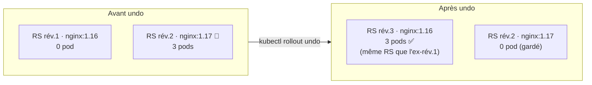

# Fiche — Rollback d'un Deployment

## 📌 En une phrase

Le **rollback** ramène un Deployment à une révision précédente en réactivant l'ancien ReplicaSet conservé à 0 pod : c'est un rolling update à l'envers, sans coupure.

> Analogie : le Ctrl+Z du déploiement… mais qui crée une nouvelle entrée dans l'historique au lieu d'effacer la dernière.

## 🏗️ Ce qui se passe

## 🔢 Le piège de la numérotation

| Action | Historique des révisions | Image active |
|---|---|---|
| Déploiement initial | 1 | nginx:1.16 |
| Mise à jour | 1, 2 | nginx:1.17 🐞 |
| `rollout undo` | 2, **3** (= ex-1) | nginx:1.16 |
| `rollout undo` encore | 3, **4** (= ex-2) | nginx:1.17 🐞 — retour au bug ! |

→ `undo` revient toujours à **l'avant-dernière** révision. Pour une version précise : `--to-revision=N`.

## ⌨️ Commandes clés

| Besoin | Commande |
|---|---|
| Historique | `kubectl rollout history deployment/<d>` |
| Contenu d'une révision | `kubectl rollout history deployment/<d> --revision=2` |
| Revenir à la précédente | `kubectl rollout undo deployment/<d>` |
| Revenir à une révision précise | `kubectl rollout undo deployment/<d> --to-revision=1` |
| Suivre | `kubectl rollout status deployment/<d>` |
| Tracer la raison | `kubectl annotate deployment/<d> kubernetes.io/change-cause="rollback bug client"` |

## 🚨 Pièges courants

- `revisionHistoryLimit: 0` → plus aucun ancien ReplicaSet, rollback impossible
- Le rollback ne restaure que le **template du pod** : pas les ConfigMaps, Secrets ou le schéma de base de données modifiés en parallèle
- En GitOps (ArgoCD), un `kubectl rollout undo` sera écrasé à la prochaine synchro : il faut faire un `git revert`
- Colonne `CHANGE-CAUSE` vide → penser à l'annotation `kubernetes.io/change-cause`

## 🎤 Question d'entretien

**Un rollback Kubernetes suffit-il toujours à annuler une release ?**
Non. Il ne revient que sur l'image et la spec du pod. Si la release a migré une base de données ou modifié une ConfigMap, il faut des migrations rétrocompatibles et versionner la configuration (idéalement dans Git, avec un `git revert` en GitOps).
